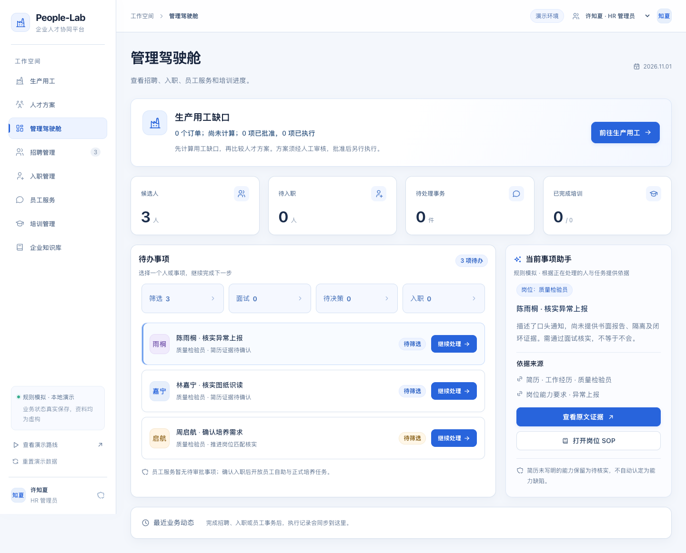
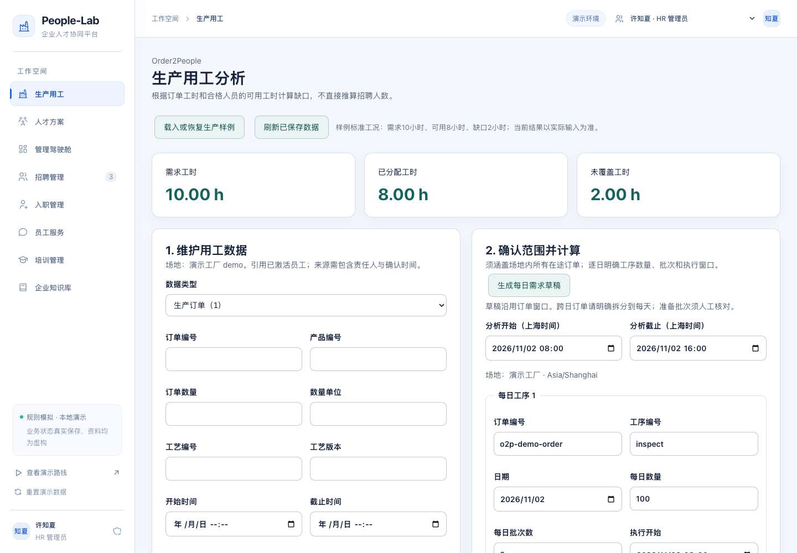
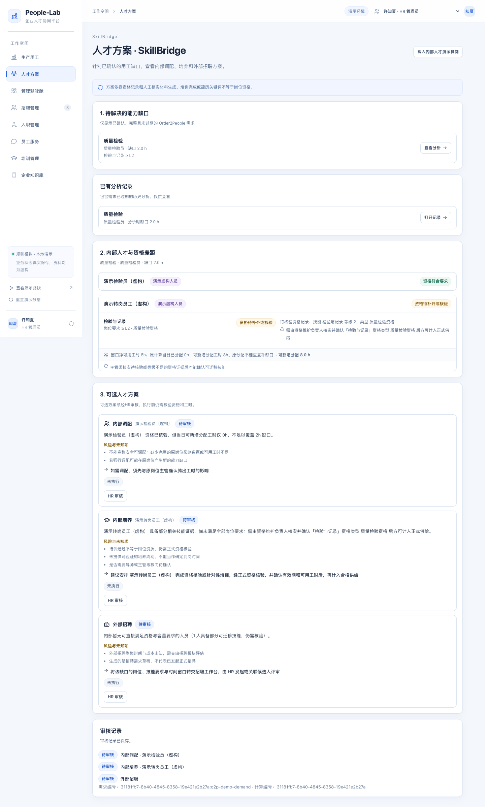
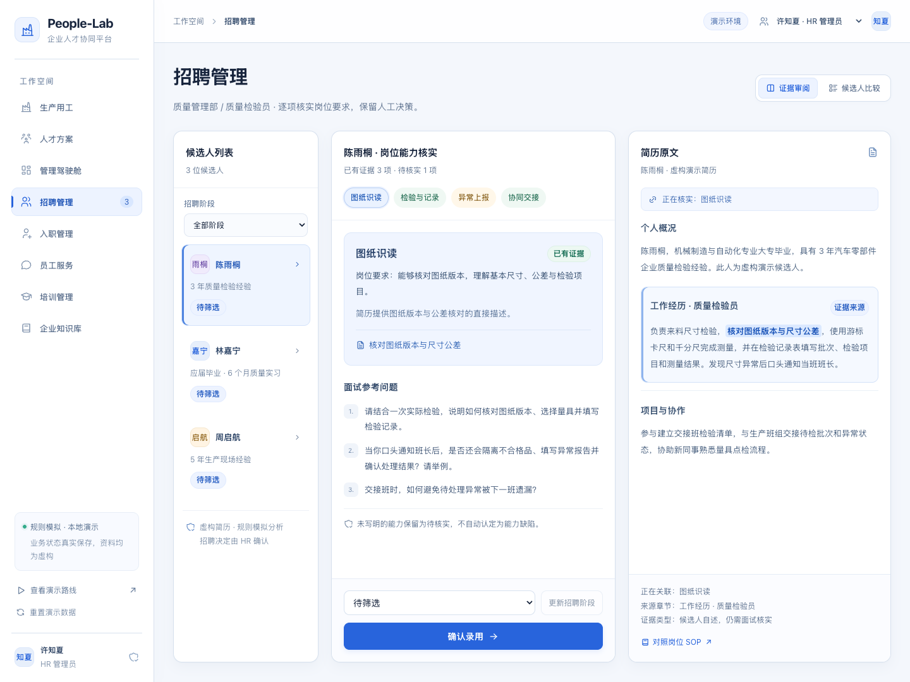
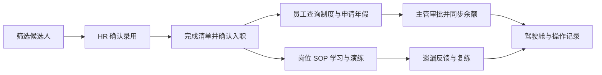
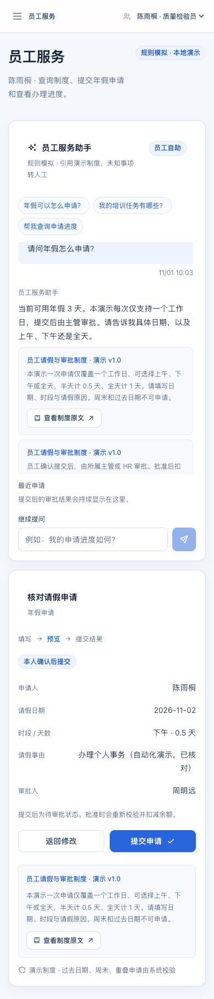

# People-Lab

## 从这里开始（2026-11-01 更新）

|你要做什么|直接阅读|
|---|---|
|评委第一次上手|[评委快速上手](docs/JUDGES-QUICKSTART.md)：启动、实际点击、预期结果与边界|
|操作完整业务|[使用说明](docs/USER-GUIDE.md)：订单→缺口→人工审核→执行反馈|
|队友继续开发|[移交文档](docs/HANDOFF.md)：代码责任、提交、输入版本与接手清单|
|交给队友的Agent|[AGENTS.md](AGENTS.md)：保护数据、权限、接口与验收规则|
|查证本轮测试|[验证记录](docs/VALIDATION.md)：50项接口、浏览器及未覆盖范围|
|查找全部说明|[文档导航](docs/README.md)：区分当前规则与历史记录|

标准样例是10h需求、8h已分配、2h缺口。同一8h不能重复补缺口；正式新增有效供给后需重新计算和确认，已验证示例为10/10/0。培训完成不等于正式资格。部分时段调配无法证明区间时会明确阻断，不宣称分钟级排程已完成。当前问答和分析为规则演示，无需模型密钥。

当前 `main` 已包含生产用工、人才方案与执行反馈，以及 [PR #8](https://github.com/ekitou7-design/People-Lab/pull/8) 的企业 HR 文案更新和 [PR #9](https://github.com/ekitou7-design/People-Lab/pull/9) 的浅色工作台与招聘页面优化。旧 HR-V2 发布包不包含当前全部能力，体验最新版请使用 `main` 源码，按下面步骤构建。


**People-Lab｜订单能力缺口与人才执行协同** · [V2 发布入口](https://github.com/ekitou7-design/People-Lab/releases/tag/HR-V2) · [Figma 可编辑设计](https://www.figma.com/design/EBXWvieYKTM1od7pnZOrwS) · [原 HR-V1 版本](https://github.com/ekitou7-design/People-Lab/releases/tag/HR-V1)

从生产订单识别能力缺口，经 HR 审核进入培养任务、招聘需求草稿或受约束的调配核验，并保留招聘、入职、员工服务和岗位培训流程：候选人录用后进入入职清单，确认入职后激活员工身份、分配培训；员工可以查询制度、申请年假，主管审批后同步余额和管理驾驶舱。

本版使用 **React + TypeScript + Vite、Node.js + Express、SQLite**。业务操作由后端校验并真实保存；AI 问答、简历证据匹配与培训反馈采用预置材料和固定规则。**无需模型密钥，安装和构建完成后可以离线演示。**



> 当前界面截图采集于 2026-11-01，基于 `main` 提交 `4533b95` 的本地构建，全部使用独立数据库中的虚构演示资料。上图为初始管理驾驶舱；下方生产用工与人才方案截图已载入演示样例，不代表初始数据。

界面延续 [Yeeflow HR](https://www.yeeflow.com/hr) 的蓝白企业风格，围绕当前人员、任务、证据与下一步操作设计。紧凑指标、待办队列与上下文助手共用实际业务记录；招聘能力与简历原文同屏；请假在同一办理卡内填写、预览、提交与追踪，制度依据全程可见。手机支持员工服务与培训，平板支持工作台。

历史 HR-V2 Figma 文件包含“01 基础组件”和“02 页面与流程”：六个桌面主页面及关键操作状态、平板工作台、手机员工服务与培训。使用原生中文文本、Auto Layout、颜色变量和组件。演示点击流程从工作台开始；实际业务与数据保存由本地 Demo 执行。详见 [UI v2 验收记录](docs/UI-v2验收记录.md)。历史 UI v2 改版的数据保留核对见 [数据保留报告](docs/design/data-preservation.json)。

## 当前界面预览

<details>
<summary>生产用工：按订单工时与合格人员容量计算缺口</summary>

标准虚构样例：需求 10h、已分配 8h、未覆盖 2h；不直接推算招聘人数。



</details>

<details>
<summary>人才方案：资格差距、内部调配、内部培养与外部招聘</summary>

消费 HR 已确认的缺口，展示内部人才证据与三类方案。截图为审核前状态；批准后才可执行，培训完成不自动取得岗位资格。



</details>

<details>
<summary>招聘管理：候选人、岗位能力与简历原文同屏核实</summary>



</details>

## 本地 Demo 功能

| 模块 | 已实现的操作 |
| --- | --- |
| 生产用工 | 维护订单、工艺、资格、班次和已有占用，按共享人员容量计算工时缺口；HR 确认后可进入人才方案。 |
| 人才方案 | 查看内部人才与资格差距，审核调配、培养与招聘方案；执行后写入受约束的容量占用、培训任务或招聘需求草稿。 |
| 招聘管理 | 一个质量检验员岗位、三名示例候选人；岗位能力要求、候选人对比、匹配证据、原文段落、待核实事项和面试问题；HR 确认录用。 |
| 入职管理 | 录用后建立待入职档案；完成资料核验、协议、岗位说明清单后确认入职，激活员工身份并自动分配培训。 |
| 员工服务 | 对话式制度咨询、引用片段和版本查看；年假申请预览、提交、进度查询；未覆盖问题转为 HR 人工工单。 |
| 主管审批 | 查看团队申请；批准或填写原因拒绝；批准时扣减年假余额，审批结果同步员工页面与驾驶舱。 |
| 岗位培训 | 阅读演示 SOP；完成“不合格品处理”情境演练，按隔离、记录、上报、跟踪四项规则反馈；遗漏后建立复练任务。 |
| 管理驾驶舱 | 招聘阶段、入职人数、申请状态、培训完成情况、待办与操作时间线；可跳转对应业务页面。 |
| 企业知识库 | 查看演示请假制度、入职指南、岗位 SOP 的正文、版本和引用片段。 |
| 演示控制 | HR、主管、员工身份切换；流程引导、示例问题、SOP 学习要点；HR 确认后重置演示数据。 |



### 真实业务与模拟 AI 的边界

| 能力 | 当前实现方式 |
| --- | --- |
| 录用、入职、请假、审批、任务流转 | Express API 执行业务校验，SQLite 事务保存状态。刷新和重启后保留。 |
| 角色与记录范围 | 后端检查 `x-demo-actor`，区分 HR、主管、员工以及个人／团队记录；属于演示身份机制，未接入真实登录。 |
| 简历匹配与证据 | 使用内置示例简历和预置证据映射；可打开原文，不包含任意简历上传或自动解析。 |
| 员工问答 | 固定资料、关键词意图和有限流程追问；附制度引用，无法覆盖的问题转人工工单。未接入 LLM 或 RAG。 |
| 培训评估 | 使用固定 SOP 规则评分；不是大模型语义评分，也不代表实际岗位资质。 |
| 协同助手 | 根据当前记录生成摘要和页面入口，不会替员工批准请假或绕过业务流程。 |

## 快速开始

### 环境准备

- **Node.js 22.13 或更新版本**，推荐 Node.js 24 LTS。SQLite 使用 Node 内置 `node:sqlite`，无需单独安装数据库。
- npm 随 Node.js 安装；首次安装依赖需要联网。
- 可从 [Node.js 官网](https://nodejs.org/en/download) 安装符合要求的版本，然后检查：

```sh
node --version
npm --version
```

下载本仓库 ZIP 并解压，或使用 Git：

```sh
git clone https://github.com/ekitou7-design/People-Lab.git
cd People-Lab
```

### Windows 一键启动

双击项目目录中的 **`启动HRFlow.cmd`**。脚本会检查依赖，必要时执行 `npm ci`，首次或源码更新后执行构建，然后在后台启动服务并打开浏览器：

**<http://127.0.0.1:3220>**

双击 **`停止HRFlow.cmd`** 停止服务，业务数据保留。脚本会核对 PID、项目路径和健康接口，只停止当前项目，不会按端口终止其他 Node 程序。再次启动会复用已验证的项目实例；端口被其他程序占用时会提示。

也可以使用 PowerShell：

```powershell
# 启动但不自动打开浏览器
powershell.exe -NoProfile -ExecutionPolicy Bypass -File .\scripts\start.ps1 -NoBrowser

# 指定端口（适用于尚未启动的实例）
powershell.exe -NoProfile -ExecutionPolicy Bypass -File .\scripts\start.ps1 -Port 3225

# 停止此项目
powershell.exe -NoProfile -ExecutionPolicy Bypass -File .\scripts\stop.ps1
```

### 命令行启动（Windows／macOS／Linux）

在项目目录执行：

```sh
npm ci
npm run build
npm start
```

浏览 <http://127.0.0.1:3220>，按 `Ctrl+C` 停止前台服务。跨平台命令使用同一套前后端代码；本版完整验收环境为 Windows。

服务默认仅监听 `127.0.0.1`。可通过 `HRFLOW_PORT` 指定端口，通过 `HRFLOW_DATA_DIR` 指定数据目录；未设置时使用端口 `3220` 和项目内 `data/`。不需要 `.env` 或模型 API Key。

## 完整演示：从候选人到员工

初始数据包含三名候选人，尚无在职员工。默认身份为 **HR 管理员许知夏**；完成入职后，顶部“切换演示身份”才会出现对应员工。

| 身份 | 演示职责 |
| --- | --- |
| HR 管理员 · 许知夏 | 招聘、录用、入职、培养需求确认、人工工单、全局统计和数据重置。 |
| 质量主管 · 周明远 | 团队事务与请假审批、团队培养进展。 |
| 员工 · 陈雨桐等 | 本人制度咨询、年假申请、申请进度、岗位学习与复练。 |

1. **招聘**：打开“招聘管理”，选择陈雨桐，查看岗位要求、原文证据和待核实事项。点击“确认录用”；培养需求只勾选已通过面试确认的项目，也可不勾选。
2. **入职**：打开“入职管理”，完成全部清单并“确认入职”。系统激活同一人的员工档案与演示身份，分配岗位必修培训和 HR 已确认的培养任务。
3. **员工咨询**：切换为陈雨桐，进入“员工服务”，问“请问年假怎么申请？”，展开引用查看制度版本与原文。
4. **提交申请**：点击“填写请假申请”，选择未来工作日下午，填写事由；预览确认 `0.5` 天后提交。申请此时待审批，余额仍为 `3` 天。
5. **主管审批**：切换为周明远，批准该申请。余额变为 `2.5` 天；拒绝申请需填写原因，拒绝不扣余额。
6. **培训与复练**：切回员工，在“培训管理”开始学习。先只选一个正确步骤提交，查看遗漏反馈；再开始复练，选择隔离、记录、上报、跟踪四个正确步骤后提交。
7. **查看结果**：切回 HR 查看“管理驾驶舱”，核对录用、入职、审批与培训状态。刷新页面或停止后重启，记录仍然保留。

三分钟现场讲稿见 [演示脚本](docs/演示脚本.md)。

<details>
<summary>查看手机宽度下的员工服务页面</summary>



</details>

### 关键业务约束

- 重复录用、入职或审批不会重复创建员工档案、分配任务或扣减余额；带操作编号的提交会检查幂等与内容冲突。
- 请假仅支持**年假**，每次一个工作日，可选上午、下午或全天。过去日期、周末、余额不足、重叠申请会被校验；日期按上海时区判断。
- 病假、婚假等未配置的假种转交 HR，不会套用年假表单；复合咨询会要求先明确一个事项。
- 简历“证据不足”保留为待核实事项，不会自动认定候选人缺乏能力。岗位必修培训和人工确认的培养需求分别记录。
- 同一原始培训任务只保留一个关联复练任务；再次失败可继续复练，通过后同步完成原任务。统计不把复练重复计入原始任务总量。
- 当前培养任务共用一套“不合格品处理”演示场景，不代表已覆盖所有岗位能力的测评。

## 数据保存、重置与离线演示

业务状态存放在 **`data/hrflow.sqlite`**，使用 SQLite WAL 和事务保存；运行中可能出现同名的 `-wal`、`-shm` 文件。存储层采用版本化业务状态与独立幂等记录表，适合本地 Demo。启动日志保存在 `data/server-output.log`、`data/server-error.log`。

刷新、关浏览器、停止服务都不会重置数据。需要重新演示时，切换为 HR，点击 **“重置演示数据”** 并确认，将清除当前演示业务记录并恢复初始三名候选人。备份数据库前先停止服务。

首次安装与构建完成后，保留 `node_modules/`、`dist/` 和项目源码即可断网演示。应用不依赖外部字体、CDN、云模型或在线数据源。复制到其他电脑时，应重新安装对应平台依赖，不要把 `node_modules/` 当作跨平台安装包。

Git 仓库只发布源码、锁文件、文档与示例截图；运行数据库、日志、依赖目录、构建结果和本地测试输出由 `.gitignore` 排除。新下载后第一次启动会生成自己的演示数据库，不包含作者本机操作记录。

## 开发与测试

```sh
npm run dev
```

开发模式启动 API `http://127.0.0.1:3220` 和 Vite 页面 `http://127.0.0.1:3221`，浏览后者。按 `Ctrl+C` 停止两个子进程。开发服务与一键启动服务使用同一默认 API 端口，应先停止已运行实例。

| 命令 | 用途 |
| --- | --- |
| `npm ci` | 按锁文件安装依赖。 |
| `npm run dev` | 启动前后端开发服务。 |
| `npm run build` | TypeScript 检查及生产构建。 |
| `npm start` | 启动后端并提供已构建前端。 |
| `npm test` | 运行接口和状态转换测试，使用临时数据库。 |
| `npm run test:e2e` | 用 Playwright 实际操作业务闭环，输出报告和截图。 |
| `npm run test:audit` | 重放 12 组规则问答与 4 类未开放能力边界检查。 |

本次截图采集使用已安装的 Chrome；以下为完整验证命令，无需下载 Chromium：

```sh
npm test
npm run build
PLAYWRIGHT_CHANNEL=chrome npm run test:e2e
npm run test:audit
```

其他测试环境需自行准备兼容浏览器；本轮没有下载 Chromium。正常运行 Demo 不需要 Playwright 测试浏览器。

**README 截图更新（2026-11-01）**：基于 `4533b95` 重新构建通过，现有 `test:e2e` 的 52 项浏览器检查通过；另在独立虚构样例库实际操作生产用工计算、HR 确认和人才方案分析，采集并人工检查 5 张当前截图，未发现浏览器运行异常。本次未重跑接口测试和问答审计，不将下列历史验收视为本次结果。

**UI v2 历史验收（2026-10-30）**：生产构建通过，14 项接口测试、52 项浏览器检查全部通过，保留原 21 项并增加 31 项；12 组规则问答及 4 类边界检查通过。生成 14 张当前界面截图，验证证据联动、知识往返保留草稿、单卡请假、角色隔离、写入后刷新失败恢复，以及 1440px 桌面、1024px 平板和 390px 手机布局。Figma 包含 16 个原生可编辑画框，设计范围和原型边界见 [设计交付说明](docs/design/README.md)。

端到端测试使用系统临时目录中的独立数据库和随机端口，不修改日常演示数据；报告与截图输出到 `test-results/`。详细范围和边界见 [验收记录](docs/验收记录.md)。以上结果验证本版规则和业务流程，不代表已完成真实模型效果评测。

## 项目结构

```text
People-Lab/
├─ src/v2/                  六个 React 页面、工作区、共享组件与统一样式
├─ server/
│  ├─ app.mjs               API、角色范围及业务规则
│  ├─ catalog.mjs           虚构岗位、简历、制度和培训场景
│  ├─ store.mjs             SQLite 事务与幂等存储
│  └─ index.mjs             本地服务入口
├─ shared/                  TypeScript 数据类型与 API 文档
├─ scripts/                 开发、浏览器验收及 Windows 启停脚本
├─ tests/                   接口自动测试
├─ docs/                    演示脚本、验收记录与截图
├─ public/                  本地静态资源
├─ 启动HRFlow.cmd            Windows 一键启动
├─ 停止HRFlow.cmd            Windows 一键停止
└─ package-lock.json        依赖版本锁定
```

API 说明见 [shared/API.md](shared/API.md)，数据约定见 [shared/contracts.ts](shared/contracts.ts)。

## 当前限制与后续方向

所有岗位、姓名、简历、企业制度和 SOP 均为虚构演示资料，不代表达智汇或任何真实企业。本版围绕一个质量检验员岗位和一条业务闭环展开，未接入真实招聘渠道、邮件、日历、飞书、Frappe HRMS、Dify 或完整 LMS。

演示身份可从页面切换，`x-demo-actor` 可被调用者指定，不具备生产认证安全性；本版仅面向本机演示，不适合直接开放到互联网。

后续可在现有业务校验与数据关联基础上接入真实模型、文档检索、简历解析、账号认证和外部系统。本地 Demo 尚未实现这些能力。

## People-Lab · Order2People 第一阶段

新增“生产需求与能力”入口，保留 HR-V2 原有功能。人工订单/工艺/资格/日历/占用 → 共享人员容量诊断 → HR 确认 → SkillBridge JSON。无 AI 模型接入，不推断招聘人数。

演示、限制、验证和交付状态见 [Order2People 交付记录](docs/ORDER2PEOPLE-DELIVERY.md)，字段及端点见 [API 契约](docs/API-CONTRACTS.md)。新增浏览器检查：`npm run test:order2people:e2e`；使用已安装 Chrome 时可设置 `PLAYWRIGHT_CHANNEL=chrome`。

## SkillBridge · 第二阶段

只读消费已确认的 Order2People 能力缺口：内部人才证据分类（已验证/潜在可迁移/证据不足）、技能差距与可用容量、内部调配/内部培养/外部招聘三类路径建议，HR 审核留痕。新增浏览器检查：`npm run test:skillbridge:e2e`。

## 人才执行闭环 · 第三阶段

HR 对已批准的 SkillBridge 方案执行真实写入，而非仅跳转页面：
- 内部培养 → 在培训工作台创建真实培训任务，回链原分析；完成任务不自动等于岗位资质，仍需人工核验。
- 外部招聘 → 在招聘工作台生成招聘需求草稿，HR 手工关联已有候选人；不自动生成候选人。
- 内部调配 → 须填写主管确认人与风险说明后，在生产需求模块写入真实容量占用，原计算结果据此过期并需重新计算确认。

字段及端点见 [API 契约](docs/API-CONTRACTS.md)，分工与授权记录见 [分工](docs/WORKSTREAMS.md)。新增浏览器检查：`npm run test:talent-execution:e2e`。

## 2026-10-31 修复说明入口

[使用说明](docs/USER-GUIDE.md) · [队友及 Agent 移交](docs/HANDOFF.md) · [本轮验证](docs/VALIDATION.md)。容量以未承诺增量为准，资格覆盖完整需求窗口；部分时段调配无法证明区间时显式阻断。历史发布/阶段记录不是本轮验收。
