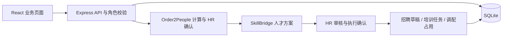
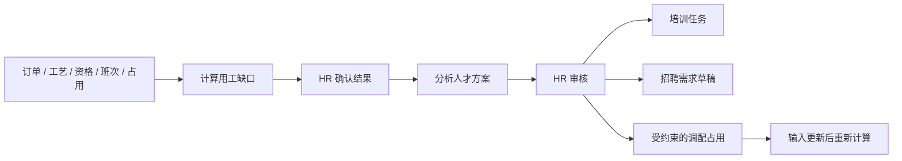

# People-Lab

**面向制造企业的人才协同平台：把生产订单转为可核对的用工缺口，再由 HR 审核落到调配、培训与招聘任务。**

React + TypeScript + Vite · Node.js + Express · SQLite。当前为本地可运行 Demo，资料均为虚构；问答与分析采用预置材料和确定规则，无需模型密钥，安装与构建后可离线演示。

[快速开始](#快速开始) · [产品截图](#产品截图) · [使用流程](#使用流程) · [评委快速上手](docs/JUDGES-QUICKSTART.md) · [完整文档](docs/README.md)

## 项目背景

制造企业的生产主管关心订单能否被现有人员覆盖，HR 则需要判断应当调配、培养还是招聘。仅看岗位编制或员工人数，无法回答指定订单窗口内的实际能力缺口：员工可能已有任务占用，技能相近也可能缺少有效岗位资格。

People-Lab 围绕这一协同问题，把订单、工艺工时、资格、班次和已有占用放入同一计算范围，再将确认后的缺口连接到人才方案与业务执行。目标是让生产主管、HR 和管理者基于同一份有来源、有版本的结果讨论下一步，而不是在各自的表格与任务之间反复对照。产品定位与阶段依据见 [产品说明](docs/PRODUCT.md)。

## 核心功能

| 模块 | 已实现的操作 |
| --- | --- |
| 生产用工 | 维护订单、工艺、资格、班次和已有占用，按共享人员容量计算工时缺口；HR 确认后可进入人才方案。 |
| 人才方案 | 查看内部人才与资格差距，审核调配、培养与招聘方案；执行后写入受约束的容量占用、培训任务或招聘需求草稿。 |
| 招聘管理 | 一个质量检验员岗位、三名示例候选人；岗位能力要求、候选人对比、匹配证据、原文段落、待核实事项和面试问题；HR 确认录用。 |
| 入职管理 | 录用后建立待入职档案；完成资料核验、协议、岗位说明清单后确认入职，激活员工身份并自动分配培训。 |
| 员工服务 | 对话式制度咨询、引用片段和版本查看；年假申请预览、提交、进度查询；未覆盖问题转为 HR 人工工单。 |
| 主管审批 | 查看团队申请；批准或填写原因拒绝；批准时扣减年假余额，审批结果同步员工页面与驾驶舱。 |
| 培训管理 | 阅读演示 SOP；完成“不合格品处理”情境演练，按隔离、记录、上报、跟踪四项规则反馈；遗漏后建立复练任务。 |
| 管理驾驶舱 | 招聘阶段、入职人数、申请状态、培训完成情况、待办与操作时间线；可跳转对应业务页面。 |
| 企业知识库 | 查看演示请假制度、入职指南、岗位 SOP 的正文、版本和引用片段。 |
| 演示控制 | HR、主管、员工身份切换；流程引导、示例问题、SOP 学习要点；HR 确认后重置演示数据。 |

## 产品亮点

People-Lab 将用工依据、人才方案与后续行动连接到同一条业务流程：

- **从订单工时出发**：计算具体技能与时间窗口的未覆盖工时，再讨论人才路径，不将缺口直接换算成招聘人数。
- **共享容量只算一次**：同一员工的可用工时在多个需求之间共同分配；标准样例为 10h 需求、8h 分配、2h 缺口，原有 8h 不能再次填补缺口。
- **结果有依据、变更有版本**：可追溯输入、资格与分配明细；输入更新后旧结果标记过期，重新计算和确认后再使用。
- **方案能落到真实任务**：经 HR 审核后，内部培养创建培训任务，外部招聘创建需求草稿，内部调配按资格与容量约束创建占用；刷新和重启后保留记录。
- **证据与人工判断同屏**：招聘页联动岗位要求与简历原文，员工服务保留制度引用，培训完成与正式上岗资格分别记录。

## 产品截图


截图采集于 2026-11-01，基于 `main` 提交 `4533b95` 的本地构建，使用独立数据库与虚构演示资料。上图为初始驾驶舱；生产用工与人才方案已载入样例。

<details>
<summary>生产用工：按订单工时与合格人员容量计算缺口</summary>

标准虚构样例：需求 10h、已分配 8h、未覆盖 2h；不直接推算招聘人数。


</details>

<details>
<summary>人才方案：资格差距、内部调配、内部培养与外部招聘</summary>

消费 HR 已确认的缺口，展示内部人才证据与三类方案。截图为审核前状态；批准后才可执行，培训完成不自动取得岗位资格。


</details>

<details>
<summary>招聘管理：候选人、岗位能力与简历原文同屏核实</summary>


</details>

<details>
<summary>手机员工服务：制度引用与年假申请预览</summary>


</details>

## 技术架构

| 层级 | 技术与职责 | 主要代码 |
| --- | --- | --- |
| 页面与交互 | React、TypeScript、Vite；角色切换、工作台与业务页面 | `src/v2/` |
| API 与业务规则 | Express；校验角色、记录范围、业务状态与幂等操作 | `server/app.mjs` |
| 用工缺口计算 | 确定性工时分配、资格和可用容量校验、输入版本与历史快照 | `server/order2people-*.mjs` |
| 人才方案与执行 | 内部人才证据分类、三类路径、HR 审核与执行写入 | `server/skillbridge-*.mjs` |
| 数据保存 | Node 内置 `node:sqlite`；SQLite 事务、WAL 与持久化 | `server/store.mjs` |
| 共享契约 | TypeScript 类型、API 字段及状态约定 | `shared/`、[API 契约](docs/API-CONTRACTS.md) |
| AI／Agent | 当前使用预置资料和固定规则；未接入 LLM、RAG 或自主执行 Agent | `server/catalog.mjs` 与业务规则代码 |



### 真实业务与模拟 AI 的边界

| 能力 | 当前实现方式 |
| --- | --- |
| 录用、入职、请假、审批、任务流转 | Express API 执行业务校验，SQLite 事务保存状态。刷新和重启后保留。 |
| 角色与记录范围 | 后端检查 `x-demo-actor`，区分 HR、主管、员工以及个人／团队记录；属于演示身份机制，未接入真实登录。 |
| 简历匹配与证据 | 使用内置示例简历和预置证据映射；可打开原文，不包含任意简历上传或自动解析。 |
| 员工问答 | 固定资料、关键词意图和有限流程追问；附制度引用，无法覆盖的问题转人工工单。未接入 LLM 或 RAG。 |
| 培训评估 | 使用固定 SOP 规则评分；不是大模型语义评分，也不代表实际岗位资质。 |
| 协同助手 | 根据当前记录生成摘要和页面入口，不会替员工批准请假或绕过业务流程。 |

## 快速开始

### 环境准备

- **Node.js 22.13 或更新版本**，推荐 Node.js 24 LTS。SQLite 使用 Node 内置 `node:sqlite`，无需单独安装数据库。
- npm 随 Node.js 安装；首次安装依赖需要联网。
- 可从 [Node.js 官网](https://nodejs.org/en/download) 安装符合要求的版本，然后检查：

```sh
node --version
npm --version
```

下载本仓库 ZIP 并解压，或使用 Git：

```sh
git clone https://github.com/ekitou7-design/People-Lab.git
cd People-Lab
```

### Windows 一键启动

双击项目目录中的 **`启动HRFlow.cmd`**。脚本会检查依赖，必要时执行 `npm ci`，首次或源码更新后执行构建，然后在后台启动服务并打开浏览器：

**<http://127.0.0.1:3220>**

双击 **`停止HRFlow.cmd`** 停止服务，业务数据保留。脚本会核对 PID、项目路径和健康接口，只停止当前项目，不会按端口终止其他 Node 程序。再次启动会复用已验证的项目实例；端口被其他程序占用时会提示。

也可以使用 PowerShell：

```powershell
# 启动但不自动打开浏览器
powershell.exe -NoProfile -ExecutionPolicy Bypass -File .\scripts\start.ps1 -NoBrowser

# 指定端口（适用于尚未启动的实例）
powershell.exe -NoProfile -ExecutionPolicy Bypass -File .\scripts\start.ps1 -Port 3225

# 停止此项目
powershell.exe -NoProfile -ExecutionPolicy Bypass -File .\scripts\stop.ps1
```

### 命令行启动（Windows／macOS／Linux）

在项目目录执行：

```sh
npm ci
npm run build
npm start
```

浏览 <http://127.0.0.1:3220>，按 `Ctrl+C` 停止前台服务。跨平台命令使用同一套前后端代码；本版完整验收环境为 Windows。

服务默认仅监听 `127.0.0.1`。可通过 `HRFLOW_PORT` 指定端口，通过 `HRFLOW_DATA_DIR` 指定数据目录；未设置时使用端口 `3220` 和项目内 `data/`。不需要 `.env` 或模型 API Key。

## 使用流程

### 从订单到人才方案：推荐演示主线

启动后保持 **HR 管理员许知夏** 身份。以下流程请使用独立演示库；载入样例会更新虚构记录与版本。

1. 进入“人才方案”，点击“载入内部人才演示样例”。
2. 进入“生产用工”，点击“载入或恢复生产样例”，核对每日数量和计算范围，勾选完整性确认，再点“确认输入并计算”。
3. 查看标准样例的 **10h 需求、8h 已分配、2h 未覆盖**，点击“HR 确认结果”。两个样例应在最终计算前载入，避免刚确认就因输入变化而过期。
4. 点击“前往人才方案”→“分析人才方案”，查看内部人才证据、资格差距和调配／培养／招聘路径。
5. 选择内部培养，点“HR 审核”，填写审核说明并批准。随后点“创建培训任务”→“确认创建”，用“查看培训任务”核对任务及来源回链。
6. 外部招聘路径需独立审核与执行，才会在“招聘管理”创建招聘需求草稿；可关联已有候选人，不会自动生成人选或录用。
7. 刷新页面，检查任务和记录仍在。内部调配还须满足资格、可用容量和主管确认要求；不能用主管确认替代硬约束。

完整点击路线、独立演示库启动方式及正式供给变化后的重算演示见 [评委快速上手](docs/JUDGES-QUICKSTART.md)；恢复与日常维护见 [使用说明](docs/USER-GUIDE.md)。



### 招聘到员工服务：保留的 HR 业务闭环

初始数据包含三名候选人，尚无在职员工。默认身份为 **HR 管理员许知夏**；完成入职后，顶部“切换演示身份”才会出现对应员工。

| 身份 | 演示职责 |
| --- | --- |
| HR 管理员 · 许知夏 | 招聘、录用、入职、培养需求确认、人工工单、全局统计和数据重置。 |
| 质量主管 · 周明远 | 团队事务与请假审批、团队培养进展。 |
| 员工 · 陈雨桐等 | 本人制度咨询、年假申请、申请进度、岗位学习与复练。 |

1. **招聘**：打开“招聘管理”，选择陈雨桐，查看岗位要求、原文证据和待核实事项。点击“确认录用”；培养需求只勾选已通过面试确认的项目，也可不勾选。
2. **入职**：打开“入职管理”，完成全部清单并“确认入职”。系统激活同一人的员工档案与演示身份，分配岗位必修培训和 HR 已确认的培养任务。
3. **员工咨询**：切换为陈雨桐，进入“员工服务”，问“请问年假怎么申请？”，展开引用查看制度版本与原文。
4. **提交申请**：点击“填写请假申请”，选择未来工作日下午，填写事由；预览确认 `0.5` 天后提交。申请此时待审批，余额仍为 `3` 天。
5. **主管审批**：切换为周明远，批准该申请。余额变为 `2.5` 天；拒绝申请需填写原因，拒绝不扣余额。
6. **培训与复练**：切回员工，在“培训管理”开始学习。先只选一个正确步骤提交，查看遗漏反馈；再开始复练，选择隔离、记录、上报、跟踪四个正确步骤后提交。
7. **查看结果**：切回 HR 查看“管理驾驶舱”，核对录用、入职、审批与培训状态。刷新页面或停止后重启，记录仍然保留。

三分钟现场讲稿见 [演示脚本](docs/演示脚本.md)。

### 关键业务约束

- 重复录用、入职或审批不会重复创建员工档案、分配任务或扣减余额；带操作编号的提交会检查幂等与内容冲突。
- 请假仅支持**年假**，每次一个工作日，可选上午、下午或全天。过去日期、周末、余额不足、重叠申请会被校验；日期按上海时区判断。
- 病假、婚假等未配置的假种转交 HR，不会套用年假表单；复合咨询会要求先明确一个事项。
- 简历“证据不足”保留为待核实事项，不会自动认定候选人缺乏能力。岗位必修培训和人工确认的培养需求分别记录。
- 同一原始培训任务只保留一个关联复练任务；再次失败可继续复练，通过后同步完成原任务。统计不把复练重复计入原始任务总量。
- 当前培养任务共用一套“不合格品处理”演示场景，不代表已覆盖所有岗位能力的测评。

## 项目进度

截至 2026-11-01，当前 `main` 已合入生产用工、人才方案、人才执行闭环，以及 [PR #8](https://github.com/ekitou7-design/People-Lab/pull/8) 的文案更新和 [PR #9](https://github.com/ekitou7-design/People-Lab/pull/9) 的浅色界面优化。

| 阶段／能力 | 当前状态 |
| --- | --- |
| HR 业务闭环 | 已实现：招聘、入职、员工服务、年假审批、培训复练和驾驶舱 |
| Order2People | 已实现：结构化输入、共享容量诊断、HR 确认及需求导出 |
| SkillBridge | 已实现：内部人才证据分类、资格差距、三类人才路径及审核 |
| 人才执行闭环 | 已实现：创建培训任务、招聘需求草稿和受约束的调配占用；不能证明部分时段区间时会阻断 |
| Capability Graph | 规划中：能力依赖与脆弱点分析，未实现 |
| Talent Simulator | 规划中：方案假设比较，未实现 |
| Talent Agent | 规划中：授权下的自动任务执行，未实现 |
| 真实模型与企业接入 | 未实现：LLM／RAG、任意简历解析、生产账号认证及外部 HR 系统连接 |

当前演示围绕一个质量检验员岗位与固定 SOP 场景。所有岗位、姓名、简历和制度均为虚构，不代表任何真实企业。部分时段调配无法证明区间时明确阻断；培训通过不自动授予资格。演示身份可由页面与 `x-demo-actor` 指定，未接入生产认证，当前面向本机演示。

**本次 README 验证（2026-11-01）**：基于 `4533b95` 重新构建通过；现有 `test:e2e` 的 52 项浏览器检查通过；另在独立虚构样例库完成 10/8/2 计算、HR 确认和人才方案分析。5 张当前截图经人工检查，无浏览器运行异常；README 相对链接与图片引用检查通过。本次未重跑接口测试与问答审计。

阶段交付与历史验收见 [Order2People 交付记录](docs/ORDER2PEOPLE-DELIVERY.md)、[验证记录](docs/VALIDATION.md)、[最终产品验收](docs/FINAL-PRODUCT-AUDIT.md)。这些报告保留各自日期，不作为本次重新验收的结果。

体验当前能力请使用 `main` 源码。历史 [HR-V2 发布包](https://github.com/ekitou7-design/People-Lab/releases/tag/HR-V2)、[HR-V1](https://github.com/ekitou7-design/People-Lab/releases/tag/HR-V1) 与 [HR-V2 Figma 设计](https://www.figma.com/design/EBXWvieYKTM1od7pnZOrwS) 留作对应版本参考，不覆盖当前全部功能和样式；原设计说明见 [设计交付](docs/design/README.md)。

### 数据保存与离线演示

业务状态存放在 **`data/hrflow.sqlite`**，使用 SQLite WAL 和事务保存；运行中可能出现同名的 `-wal`、`-shm` 文件。存储层采用版本化业务状态与独立幂等记录表，适合本地 Demo。启动日志保存在 `data/server-output.log`、`data/server-error.log`。

刷新、关浏览器、停止服务都不会重置数据。需要重新演示时，切换为 HR，点击 **“重置演示数据”** 并确认，将清除当前演示业务记录并恢复初始三名候选人。备份数据库前先停止服务。

首次安装与构建完成后，保留 `node_modules/`、`dist/` 和项目源码即可断网演示。应用不依赖外部字体、CDN、云模型或在线数据源。复制到其他电脑时，应重新安装对应平台依赖，不要把 `node_modules/` 当作跨平台安装包。

Git 仓库只发布源码、锁文件、文档与示例截图；运行数据库、日志、依赖目录、构建结果和本地测试输出由 `.gitignore` 排除。新下载后第一次启动会生成自己的演示数据库，不包含作者本机操作记录。

## 开发与维护

| 命令 | 用途 |
| --- | --- |
| `npm run dev` | API 默认 `3220`，Vite 页面默认 `3221`；应先停止占用同一 API 端口的启动实例 |
| `npm run build` | TypeScript 检查与生产构建 |
| `npm test` | 使用临时库的接口与状态转换测试 |
| `npm run test:e2e` | HR 闭环、响应式布局、截图与浏览器检查 |
| `npm run test:order2people:e2e` | 生产用工浏览器检查 |
| `npm run test:skillbridge:e2e` | 人才方案浏览器检查 |
| `npm run test:talent-execution:e2e` | 人才执行闭环浏览器检查 |
| `npm run test:audit` | 规则问答与未开放能力边界检查 |

使用已安装的 Chrome 运行浏览器检查时，在命令前设置 `PLAYWRIGHT_CHANNEL=chrome`。业务测试使用独立临时数据库，输出到 `test-results/`；日常启动数据不用于测试。

```text
People-Lab/
├─ src/v2/          React 页面、工作区、共享组件与样式
├─ server/          API、计算引擎、人才规则、演示资料与 SQLite 存储
├─ shared/          TypeScript 类型与 API 文档
├─ scripts/         开发、浏览器检查及 Windows 启停脚本
├─ tests/           接口与业务规则测试
├─ docs/            使用说明、契约、阶段交付、验证与截图
└─ public/          本地静态资源
```

| 需要什么 | 文档入口 |
| --- | --- |
| 操作与演示 | [评委快速上手](docs/JUDGES-QUICKSTART.md)、[使用说明](docs/USER-GUIDE.md)、[演示脚本](docs/演示脚本.md) |
| 继续开发 | [移交文档](docs/HANDOFF.md)、[协作规则](AGENTS.md)、[API 契约](docs/API-CONTRACTS.md) |
| 数据与接口 | [共享类型](shared/contracts.ts)、[HR API](shared/API.md) |
| 其他资料 | [文档导航](docs/README.md) |

## 团队与致谢

项目贡献者见 [GitHub Contributors](https://github.com/ekitou7-design/People-Lab/graphs/contributors)，阶段职责与交接记录见 [WORKSTREAMS](docs/WORKSTREAMS.md)。具体成员职责以实际认领和提交记录为准。

界面风格参考 [Yeeflow HR](https://www.yeeflow.com/hr) 的蓝白企业视觉；项目使用 React、Vite、Express、SQLite、Tabler Icons 和 Playwright 等开源工具，依赖版本见 [package.json](package.json)。仓库当前未提供 `LICENSE` 文件。
